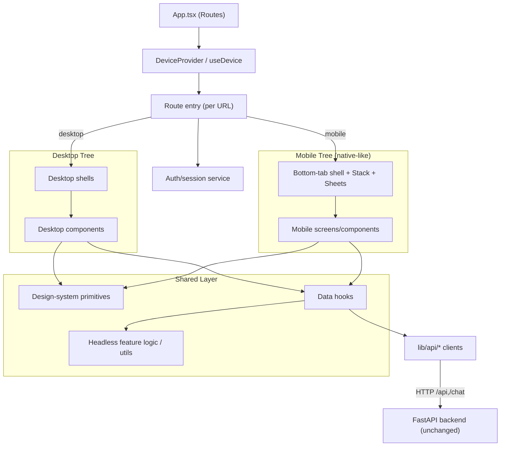

# Component Dependencies & Data Flow

## Dependency Diagram



## Dependency Matrix

| Component | Depends on | Change type |
|---|---|---|
| App.tsx | DeviceProvider, route entries, guards | Minor (wrap + entries) |
| DeviceProvider/useDevice | browser matchMedia APIs | New |
| Route entries | useDevice, desktop tree, mobile tree | New (thin) |
| Desktop tree | shared primitives, data hooks | Major (restyle/rebuild) |
| Mobile tree | shared primitives, data hooks, shell nav | New (native-like) |
| Shared primitives | design tokens (theme.css) | New/Refactor |
| Data hooks | lib/api clients | Refactor (extract from components) |
| lib/api clients | backend REST (unchanged) | None (contract stable) |
| Auth/session | localStorage | None |
| PWA/SW | app shell assets | Minor (complete/verify) |

## Communication Patterns
- **Top-down device selection**: `DeviceProvider` resolves class → route entry renders exactly one
  tree. Trees never import each other.
- **Shared downward dependencies**: both trees depend on shared primitives + hooks; shared layer
  never imports tree-specific code (prevents cycles).
- **Data flow**: components → data hooks → api clients → backend; responses flow back up. No tree
  duplicates data logic.
- **Navigation**: desktop uses router + in-page tabs; mobile uses bottom tabs + a stack navigator +
  sheet host, all within the same URL space (routes swapped by device, not duplicated).

## Data Flow (representative: trainee books on mobile)
```
BottomTab(Booking) -> MobileBookingScreen
  -> useBookingAvailability(customerId)  -> lib/api/bookings.availability -> GET /api/v1/bookings/availability
  -> tap slot -> SheetHost(confirm) -> useCreateBooking() -> POST /api/v1/bookings
  -> refetch availability; show confirmation toast
```

## Cycle-Prevention Rules
- `shared/*` MUST NOT import from `desktop/*` or `mobile/*`.
- `desktop/*` and `mobile/*` MUST NOT import each other.
- Cross-tree reuse happens only via `shared/*`.
