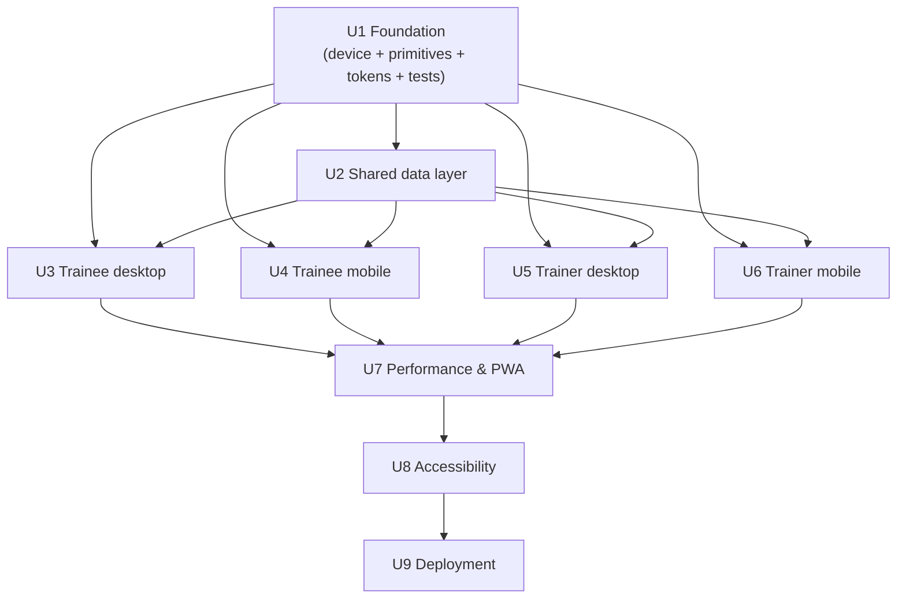

# Unit of Work — Dependencies

## Dependency Diagram

## Dependency Matrix

| Unit | Depends on | Blocks | Notes |
|---|---|---|---|
| U1 Foundation | — | U2–U6 | Must be first; device layer + primitives + tokens + test harness |
| U2 Shared data layer | U1 | U3–U6 | Feature units consume shared hooks |
| U3 Trainee desktop | U1, U2 | U7 | Independent of trainer units |
| U4 Trainee mobile | U1, U2 | U7 | Independent of desktop trainee (separate tree) |
| U5 Trainer desktop | U1, U2 | U7 | Independent of trainee units |
| U6 Trainer mobile | U1, U2 | U7 | Independent of trainer desktop (separate tree) |
| U7 Performance & PWA | U3–U6 | U8 | Optimize once feature UIs exist (code-splitting needs the trees) |
| U8 Accessibility | U7 (pref.) | U9 | Cross-cutting pass across both trees |
| U9 Deployment | U8 | — | Ships the finished frontend |

## Parallelization Opportunities
- After U1 + U2, the four feature units (U3, U4, U5, U6) are mutually independent and could be built
  in parallel if capacity allowed. The approved **sequential** order is U3 → U4 → U5 → U6.
- U7/U8 are cross-cutting and intentionally run after features (per plan Q4=A).

## Coordination Points
- **Shared contracts**: U1 primitives + U2 hook signatures are the shared interfaces every feature
  unit depends on — stabilize them in U1/U2 before feature work.
- **Testing checkpoints**: each unit passes `npm run build` + its tests before the next begins
  (per NFR-8). Parity is verified per feature unit against current behavior.
- **Rollback**: frontend-only, git-reversible per unit.
