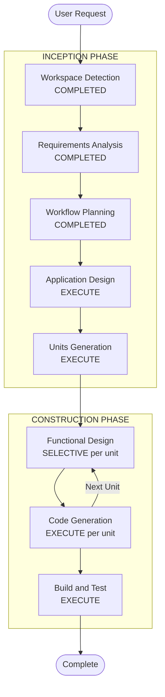

# Execution Plan — Admin UX & Feature Improvements (V2)

## Detailed Analysis Summary

### Transformation Scope
- **Transformation Type**: Multi-component enhancement (no architectural shift)
- **Primary Changes**: New admin views, new data models (BlockedSlot, Customer.active flag), calendar interaction modes, notification transport change (poll → push), UI density pass
- **Related Components**: admin API, booking service, frontend admin views, frontend member views, service worker, notification hooks

### Change Impact Assessment
- **User-facing changes**: Yes — member home dashboard redesign, body composition ring, push notifications
- **Structural changes**: Partial — admin tab structure changes, new "Today" view, member detail 2-column layout
- **Data model changes**: Yes — BlockedSlot collection, Customer.active field, push subscription storage, batch booking endpoint
- **API changes**: Yes — new endpoints (block slots, batch assign, PT CRUD member, push subscribe), modified endpoints (customers list gains active filter)
- **NFR impact**: Partial — notification transport change (poll → push), micro-interaction polish (no perf-critical changes)

### Risk Assessment
- **Risk Level**: Medium (multiple components, but each is well-scoped; rollback is per-unit)
- **Rollback Complexity**: Easy (feature flags not needed — each unit is independently deployable)
- **Testing Complexity**: Moderate (push notifications require manual device testing)

## Workflow Visualization

## Phases to Execute

### INCEPTION PHASE
- [x] Workspace Detection (COMPLETED — brownfield resume)
- [x] Reverse Engineering (SKIPPED — artifacts from prior cycle still current)
- [x] Requirements Analysis (COMPLETED — requirements-v2.md approved)
- [x] User Stories (SKIPPED — operational tool for 1 PT, stories add no value)
- [x] Workflow Planning (IN PROGRESS)
- [ ] Application Design — **EXECUTE**
  - **Rationale**: New components needed (Today screen, batch booking mode, block-off management, member CRUD forms, push subscription, body composition ring). Service layer additions (batch assign, block slots, push delivery). Component dependencies need clarification.
- [ ] Units Generation — **EXECUTE**
  - **Rationale**: 11 FRs + NFRs need decomposition into sequenced units. Multiple data model changes, multiple new views, one transport change — cannot be done in a single unit without risk.

### CONSTRUCTION PHASE (per-unit loop)
- [ ] Functional Design — **SELECTIVE** (per unit, for units with new data models or complex logic)
  - **Rationale**: Same adaptive policy as the prior cycle — skip for pure UI units, execute for units adding collections/endpoints
- [ ] NFR Requirements — **SKIP** (established in prior cycle, no new NFR concerns beyond micro-interactions which are documented in requirements-v2.md NFR-1)
  - **Rationale**: No new perf/security/scalability requirements. Chart library decision = keep recharts. Push is a transport change documented in FR-10.
- [ ] NFR Design — **SKIP** (same rationale as NFR Requirements)
- [ ] Infrastructure Design — **SKIP** (no infrastructure changes — Docker/Caddy/MongoDB setup is stable from U9)
- [ ] Code Generation — **EXECUTE** (always, per unit)
- [ ] Build and Test — **EXECUTE** (always, after all units)

### OPERATIONS PHASE
- [ ] Operations — PLACEHOLDER (no changes)

## Estimated Scope

- **Total Inception stages remaining**: 2 (Application Design + Units Generation)
- **Estimated Construction units**: 6–8 (TBD in Units Generation — rough breakdown: admin density/layout, Today screen, batch pre-booking, block-off slots, PT member CRUD, client list improvements, member home dashboard + body composition, web push + remove polling)
- **Estimated effort per unit**: 1–2 sessions each

## Success Criteria

- **Primary Goal**: The PT opens the app and sees today's schedule + pending actions immediately (zero navigation to start working)
- **Key Deliverables**:
  - Admin "Today" landing screen
  - Batch pre-booking with multi-day slot painting
  - Block-off slots with assisted booking cancellation
  - PT can create/edit/archive members
  - Denser, more information-rich admin layout
  - Member home dashboard with real data (next session, progress)
  - Web Push notifications (replace polling)
  - Polished micro-interactions (skeletons, stagger, haptics, empty states)
- **Quality Gates**:
  - All existing tests pass after each unit
  - Frontend build clean (no errors)
  - Backend `import src.main` succeeds
  - Docker compose up healthy
