# Execution Plan

## Detailed Analysis Summary

### Transformation Scope (Brownfield)
- **Transformation Type**: Frontend application rebuild (no backend/API contract changes).
- **Primary Changes**: Rebuild authenticated frontend (dashboards, auth pages, shared components)
  to conform to `DESIGN.md`; introduce a **distinct native-like mobile UI** via device-based
  rendering; complete the PWA; improve load + runtime performance; fix dashboard styling defects;
  add a Vitest/RTL/fast-check test suite; deploy via Docker Compose on a single cloud VM.
- **Related Components**: `frontend/src/app/*` (pages/components), `frontend/src/lib/*` (clients,
  auth, SW registration), `frontend/public/*` (PWA), `frontend/rules/DESIGN.md` (authority),
  Docker/compose (deployment). Backend consumed as-is.

### Change Impact Assessment
- **User-facing changes**: Yes — full rebuild of the authenticated experience for both personas.
- **Structural changes**: Yes (frontend) — dual desktop/mobile component trees + device detection;
  code-splitting. No backend structural change.
- **Data model changes**: No.
- **API changes**: No — existing REST endpoints consumed unchanged.
- **NFR impact**: Yes — performance (load + runtime), accessibility, PWA, testability, deployment.

### Component Relationships
- **Primary Component**: `frontend` SPA.
- **Shared Components**: booking calendars, chat panel + artifacts, InBody charts, notifications,
  onboarding, UI primitives (`components/ui`), API clients (`lib/api`), auth helpers.
- **Dependent Components**: none downstream (frontend is the top of the stack).
- **Supporting Components**: PWA assets, Docker/compose for deployment.
- **Backend**: unchanged dependency (stable API contract).

### Risk Assessment
- **Risk Level**: Medium — large frontend surface area, but backend untouched, changes are
  reversible via git, and there are no data migrations.
- **Rollback Complexity**: Easy (frontend-only; revert build).
- **Testing Complexity**: Moderate — new test tooling plus parity verification across two device UIs.

## Workflow Visualization

```mermaid
flowchart TD
    Start(["User Request"])

    subgraph INCEPTION["INCEPTION PHASE"]
        WD["Workspace Detection - COMPLETED"]
        RE["Reverse Engineering - COMPLETED"]
        RA["Requirements Analysis - COMPLETED"]
        US["User Stories - COMPLETED"]
        WP["Workflow Planning - IN PROGRESS"]
        AD["Application Design - EXECUTE"]
        UG["Units Generation - EXECUTE"]
    end

    subgraph CONSTRUCTION["CONSTRUCTION PHASE"]
        FD["Functional Design - EXECUTE (per-unit, selective)"]
        NFRA["NFR Requirements - EXECUTE"]
        NFRD["NFR Design - EXECUTE"]
        ID["Infrastructure Design - EXECUTE (light)"]
        CG["Code Generation - EXECUTE"]
        BT["Build and Test - EXECUTE"]
    end

    subgraph OPERATIONS["OPERATIONS PHASE"]
        OPS["Operations - PLACEHOLDER"]
    end

    Start --> WD
    WD --> RE
    RE --> RA
    RA --> US
    US --> WP
    WP --> AD
    AD --> UG
    UG --> FD
    FD --> NFRA
    NFRA --> NFRD
    NFRD --> ID
    ID --> CG
    CG --> BT
    BT --> OPS
    OPS --> End(["Complete"])

    style WD fill:#4CAF50,stroke:#1B5E20,stroke-width:3px,color:#fff
    style RE fill:#4CAF50,stroke:#1B5E20,stroke-width:3px,color:#fff
    style RA fill:#4CAF50,stroke:#1B5E20,stroke-width:3px,color:#fff
    style US fill:#4CAF50,stroke:#1B5E20,stroke-width:3px,color:#fff
    style WP fill:#4CAF50,stroke:#1B5E20,stroke-width:3px,color:#fff
    style AD fill:#FFA726,stroke:#E65100,stroke-width:3px,stroke-dasharray: 5 5,color:#000
    style UG fill:#FFA726,stroke:#E65100,stroke-width:3px,stroke-dasharray: 5 5,color:#000
    style FD fill:#FFA726,stroke:#E65100,stroke-width:3px,stroke-dasharray: 5 5,color:#000
    style NFRA fill:#FFA726,stroke:#E65100,stroke-width:3px,stroke-dasharray: 5 5,color:#000
    style NFRD fill:#FFA726,stroke:#E65100,stroke-width:3px,stroke-dasharray: 5 5,color:#000
    style ID fill:#FFA726,stroke:#E65100,stroke-width:3px,stroke-dasharray: 5 5,color:#000
    style CG fill:#4CAF50,stroke:#1B5E20,stroke-width:3px,color:#fff
    style BT fill:#4CAF50,stroke:#1B5E20,stroke-width:3px,color:#fff
    style OPS fill:#BDBDBD,stroke:#424242,stroke-width:2px,stroke-dasharray: 5 5,color:#000
    style INCEPTION fill:#BBDEFB,stroke:#1565C0,stroke-width:3px,color:#000
    style CONSTRUCTION fill:#C8E6C9,stroke:#2E7D32,stroke-width:3px,color:#000
    style OPERATIONS fill:#FFF59D,stroke:#F57F17,stroke-width:3px,color:#000
    style Start fill:#CE93D8,stroke:#6A1B9A,stroke-width:3px,color:#000
    style End fill:#CE93D8,stroke:#6A1B9A,stroke-width:3px,color:#000

    linkStyle default stroke:#333,stroke-width:2px
```

### Text Alternative (workflow)
- INCEPTION: Workspace Detection (DONE) → Reverse Engineering (DONE) → Requirements Analysis (DONE)
  → User Stories (DONE) → Workflow Planning (IN PROGRESS) → Application Design (EXECUTE) →
  Units Generation (EXECUTE)
- CONSTRUCTION (per unit): Functional Design (EXECUTE, selective) → NFR Requirements (EXECUTE) →
  NFR Design (EXECUTE) → Infrastructure Design (EXECUTE, light) → Code Generation (EXECUTE) →
  then Build and Test (EXECUTE, after all units)
- OPERATIONS: Placeholder (deployment handled via Infrastructure Design + Build and Test).

## Phases to Execute

### 🔵 INCEPTION PHASE
- [x] Workspace Detection (COMPLETED)
- [x] Reverse Engineering (COMPLETED)
- [x] Requirements Analysis (COMPLETED)
- [x] User Stories (COMPLETED)
- [x] Workflow Planning (IN PROGRESS)
- [ ] Application Design — **EXECUTE**
  - **Rationale**: Define the frontend architecture for device-based rendering — desktop vs mobile
    component trees, the detection strategy, shared-logic/hook organization, design-token layer, and
    routing/lazy-loading structure. This is genuinely new structure worth designing before coding.
- [ ] Units Generation — **EXECUTE**
  - **Rationale**: The work decomposes into multiple units (foundation + per-persona/per-device
    feature areas) that map to the stories; a structured breakdown enables ordered delivery.

### 🟢 CONSTRUCTION PHASE (per unit)
- [ ] Functional Design — **EXECUTE (selective, per-unit)**
  - **Rationale**: Execute for units with real logic (device detection, availability/format
    utilities, chat artifact handling); SKIP for pure-styling units. Captures testable properties
    (PBT-01) where applicable.
- [ ] NFR Requirements — **EXECUTE**
  - **Rationale**: Performance (load + runtime), accessibility, PWA, and test-framework selection
    (fast-check per PBT-09) are central; tech-stack test additions defined here.
- [ ] NFR Design — **EXECUTE**
  - **Rationale**: Design the code-splitting strategy, device-rendering architecture patterns,
    memoization/virtualization approach, PWA behavior, and test structure.
- [ ] Infrastructure Design — **EXECUTE (light)**
  - **Rationale**: Deployment is in scope — define production frontend serving + Docker Compose
    topology for a single cloud VM.
- [ ] Code Generation — **EXECUTE (ALWAYS)**
  - **Rationale**: Implement the rebuild per unit with tests.
- [ ] Build and Test — **EXECUTE (ALWAYS)**
  - **Rationale**: `npm run build` gate + run the new frontend test suite; verify parity.

### 🟡 OPERATIONS PHASE
- [ ] Operations — **PLACEHOLDER**
  - **Rationale**: Formal Operations workflow is a future placeholder; deployment for this project
    is handled via Infrastructure Design + Build and Test (Docker Compose on a VM).

## Package/Unit Change Sequence (Brownfield)
1. **Foundation unit** (must be first) — device-based rendering + design-token layer + test setup
   (EN-1, EN-2, EN-7). Everything else depends on this.
2. **Trainee experience units** — mobile shell + desktop shell, then booking, chat, progress/profile
   (TS-1…TS-10).
3. **Trainer experience units** — desktop master-detail + mobile management, booking mgmt, InBody,
   notifications (TR-1…TR-7).
4. **Cross-cutting NFR units** — performance (EN-4/EN-5), accessibility (EN-6), PWA completion (EN-3).
5. **Deployment unit** (last) — Docker Compose production deploy (EN-8).

> Exact unit boundaries are finalized in Units Generation.

## Estimated Timeline
- **Total stages to execute**: 2 remaining INCEPTION + 6 CONSTRUCTION (per-unit loop) = large effort.
- **Estimated Duration**: Multi-session; paced by per-unit approval gates.

## Success Criteria
- **Primary Goal**: A polished, `DESIGN.md`-conformant frontend with a native-like mobile UI
  (device-based rendering), completed PWA, better performance, and no loss of functionality.
- **Key Deliverables**: Rebuilt desktop + mobile UIs, completed PWA, code-splitting, frontend test
  suite, Docker Compose deployment + docs.
- **Quality Gates**: `npm run build` passes; frontend tests pass; feature parity verified;
  `DESIGN.md` conformance checklist satisfied.
