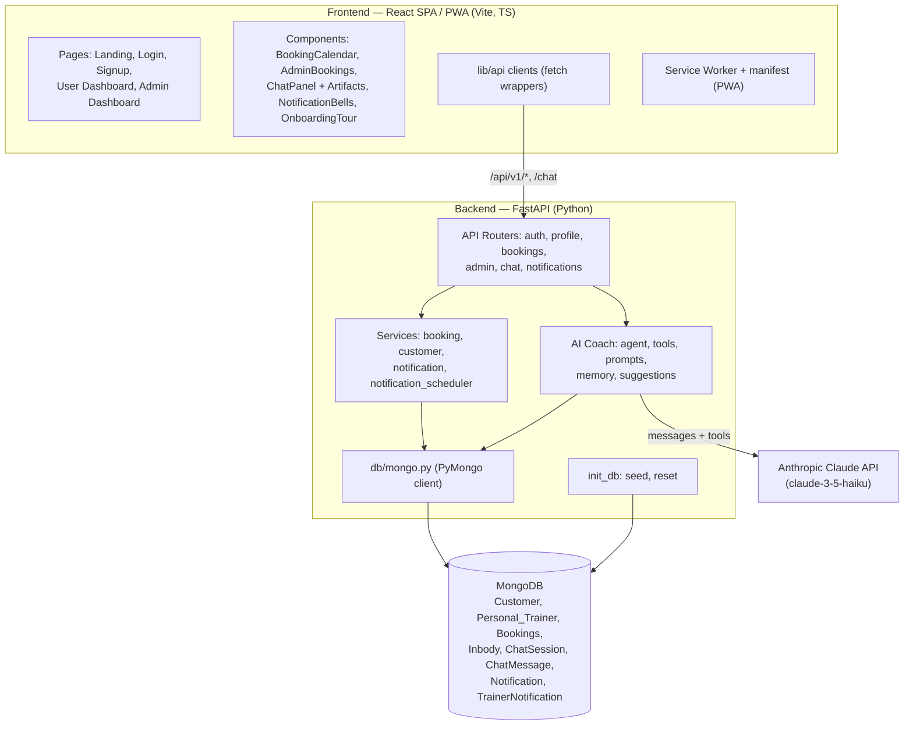
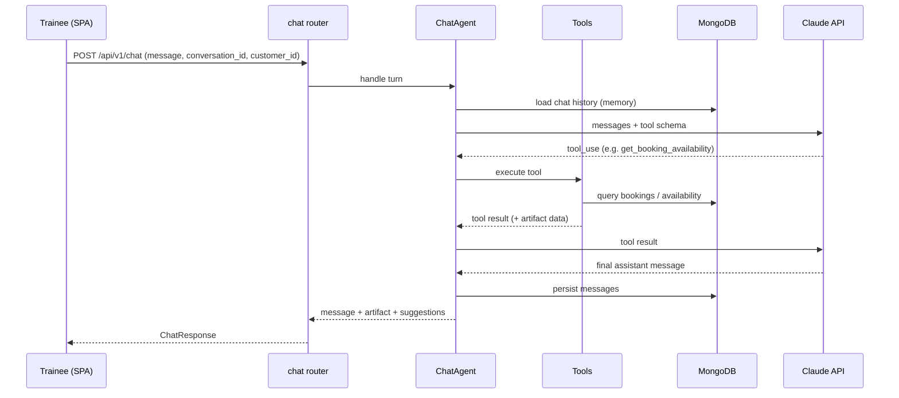

# System Architecture

## System Overview

Renfit is a two-tier web application: a React 18 + Vite + TypeScript single-page app (also a PWA)
talking over REST to a Python FastAPI backend, which persists to MongoDB and calls the Anthropic
Claude API for AI coaching. The whole stack is containerized with Docker Compose (backend +
frontend services).

## Architecture Diagram

## Component Descriptions

### Frontend SPA (`frontend/src`)
- **Purpose**: Trainee + trainer web UI, installable as a PWA.
- **Responsibilities**: Routing (react-router), auth/session in localStorage, dashboards, booking
  calendars, AI chat with interactive artifacts, notifications, onboarding, responsive layouts.
- **Dependencies**: Backend REST API (via Vite proxy for `/api` and `/chat`).
- **Type**: Application.

### Backend API Routers (`backend/src/api`)
- **Purpose**: HTTP surface for all business capabilities.
- **Responsibilities**: Request validation (Pydantic), delegate to services/AI, shape responses.
- **Dependencies**: Services, AI Coach, MongoDB layer, config settings.
- **Type**: Application.

### AI Coach (`backend/src/services/ai`)
- **Purpose**: Claude-backed conversational coaching + tool use.
- **Responsibilities**: `agent.py` (conversation loop), `tools.py` (profile/InBody/booking tools),
  `prompts.py` (system prompt, date-grounding lookup table), `memory.py` (chat history),
  `suggestions.py` (suggested-reply chips).
- **Dependencies**: MongoDB, Anthropic SDK, booking service.
- **Type**: Application (AI orchestration).

### Domain Services (`backend/src/services`)
- **Purpose**: Business logic outside the AI path.
- **Responsibilities**: `booking_service.py` (availability, create/cancel/assign, status),
  `customer_service.py`, `notification_service.py` (customer + trainer notifications),
  `notification_scheduler.py` (async session-reminder loop).
- **Dependencies**: MongoDB layer, schema models.
- **Type**: Application.

### Data Layer (`backend/src/db`, `backend/src/schema`)
- **Purpose**: MongoDB access and document schemas.
- **Responsibilities**: `db/mongo.py` connection + typed collection accessors; `schema/*`
  Pydantic/document models and collection-name constants.
- **Dependencies**: PyMongo, settings.
- **Type**: Model / Data access.

### Bootstrap & Config (`backend/src/main.py`, `backend/src/config`, `backend/src/init_db`)
- **Purpose**: App startup, settings, DB seeding.
- **Responsibilities**: FastAPI app, CORS, router registration, startup hooks (stale-index drop,
  admin seed, reminder scheduler), settings from `env/.env`, seed/reset scripts.
- **Type**: Application / Infrastructure.

## Data Flow

### AI Coach booking conversation (representative workflow)

## Integration Points
- **External APIs**: Anthropic Claude Messages API (model `claude-3-5-haiku-20241022`).
- **Databases**: MongoDB (`renfit` database) via PyMongo.
- **Third-party Services**: None beyond Anthropic.

## Infrastructure Components
- **Containers**: `Dockerfile.backend`, `Dockerfile.frontend`, orchestrated by `docker-compose.yml`.
- **Deployment Model**: Two containers — backend (uvicorn/FastAPI on :8000, health-checked) and
  frontend (Vite dev server on :5173, proxying `/api` and `/chat` to backend).
- **Networking**: Compose default network; CORS restricted to localhost dev origins via settings.
- **Note**: No cloud IaC (CDK/Terraform/CloudFormation) present; deployment is container-based.
