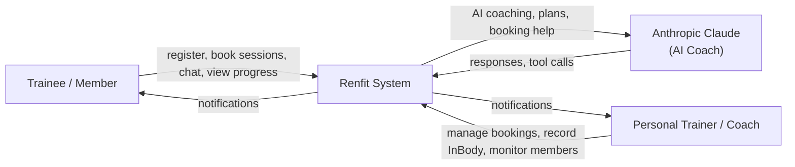

# Business Overview

## Business Context Diagram

## Business Description

- **Business Description**: Renfit is a management system for a private gym. It gives both
  personal trainers (PT) and trainees a single online place to handle session calendar booking,
  record and track InBody body-composition scores, maintain member profiles, and get AI-assisted
  fitness coaching. The AI Coach (backed by Anthropic Claude) motivates trainees, answers training
  and nutrition questions, surfaces InBody progress, and helps book/cancel sessions. Trainers use
  an admin dashboard to approve bookings, record InBody measurements, and monitor member status.

- **Business Transactions**:
  - **Member Registration & Authentication** — trainee signs up with profile details (goal, age,
    height, weight, health notes) and logs in via phone + password.
  - **Trainer Authentication** — trainer logs into the admin/coach dashboard.
  - **Session Booking** — trainee views a two-week availability grid, books an open slot (pending),
    and can cancel; slots are capacity-limited per hour, gym closed Sundays.
  - **Booking Approval / Assignment** — trainer approves, rejects, or resets booking status, and can
    directly assign a session to a member.
  - **InBody Recording & Progress Tracking** — trainer records InBody measurements (weight, SMM, BFM,
    etc.); trainee views history and progress charts.
  - **AI Coaching Conversation** — trainee chats with the AI Coach, which can read profile/InBody
    data and act on bookings through tools, returning interactive UI artifacts.
  - **Notifications** — trainees are notified on booking approval, upcoming-session reminders, and new
    InBody scores; trainers are notified on booking changes and new trainee registration.

- **Business Dictionary**:
  - **Trainee / Member (Customer)**: A gym client who books sessions and receives coaching.
  - **Personal Trainer (PT) / Coach**: Staff who train members and manage the schedule.
  - **InBody**: A body-composition measurement (weight, SMM = skeletal muscle mass, BFM = body fat
    mass, etc.) recorded over time to track progress.
  - **Booking / Slot**: A one-hour reservation for a training session at a specific date and hour.
  - **Booking Status**: `pending` (awaiting trainer), `approved` (confirmed), `rejected`.
  - **AI Coach**: The Claude-backed conversational assistant embedded in the trainee experience.
  - **Artifact**: A structured, interactive UI card the AI Coach returns (profile, InBody progress,
    booking availability, booking confirmation/cancellation).

## Component Level Business Descriptions

### Backend API (FastAPI, `backend/src/api`)
- **Purpose**: Exposes all business capabilities as REST endpoints for the web client.
- **Responsibilities**: Auth (trainee/trainer), profile & InBody, bookings, admin management,
  AI chat proxy, notifications.

### AI Coach Service (`backend/src/services/ai`)
- **Purpose**: Orchestrates the Claude conversation, tools, prompts, memory, and suggested replies.
- **Responsibilities**: Turn user intent into safe tool calls (profile read, InBody history,
  booking availability, book/cancel) and return conversational text plus UI artifacts.

### Booking & Notification Services (`backend/src/services`)
- **Purpose**: Encapsulate booking rules and the notification lifecycle.
- **Responsibilities**: Availability computation, capacity/past-slot rules, status transitions,
  customer and trainer notifications, background session-reminder scheduling.

### Frontend SPA (React, `frontend/src`)
- **Purpose**: The trainee and trainer web experience (also an installable PWA).
- **Responsibilities**: Dashboards, booking calendars, profile/InBody views, AI chat panel with
  artifacts, notification bells, onboarding tour, responsive/mobile layouts.
