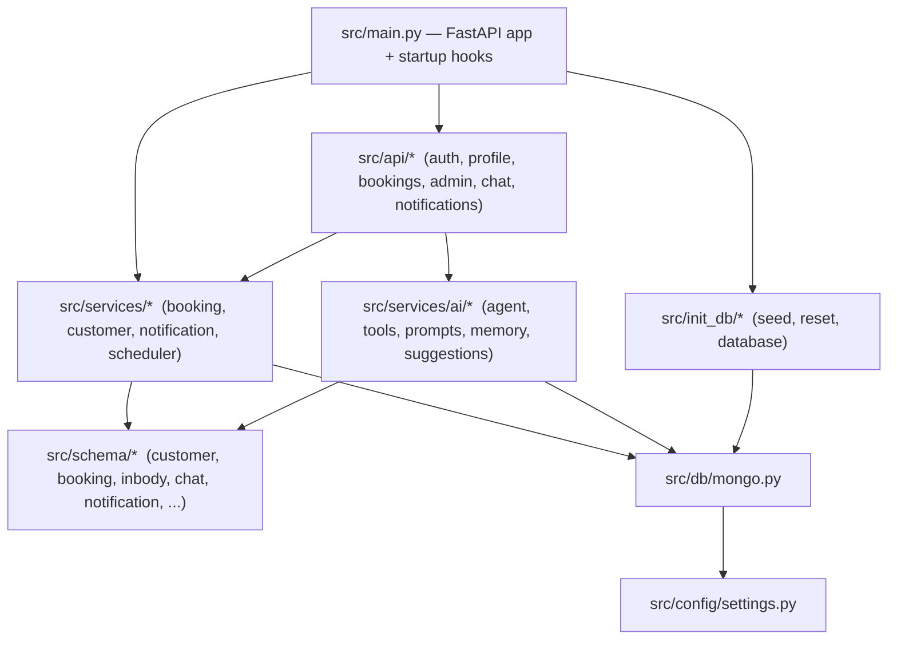

# Code Structure

## Build System
- **Backend**: Python, dependencies pinned in `backend/requirements.txt` (installed via pip; a
  pypoetry venv is used locally). Entry point `src/main.py` (FastAPI app run with uvicorn).
  Tests via `pytest` (`backend/pytest.ini`, `backend/test/`).
- **Frontend**: npm + Vite 6. Scripts: `dev` (Vite dev server), `build` (Vite production build).
  Tailwind CSS 4 via `@tailwindcss/vite`. No separate typecheck/test runner configured.
- **Containers**: `Dockerfile.backend`, `Dockerfile.frontend`, `docker-compose.yml` at repo root.

## Module Hierarchy

## Existing Files Inventory

### Backend (`backend/src`)
- `main.py` — FastAPI app, CORS, router registration, startup hooks (stale-index drop, admin seed, reminder scheduler), `/api/v1/health`.
- `constants.py` — shared constants.
- `config/settings.py` — Pydantic settings from `env/.env` (Anthropic, MongoDB, server, AI coach).
- `db/mongo.py` — PyMongo client + collection accessors.
- `api/auth.py` — signup/login (customer), password hashing (bcrypt/passlib).
- `api/profile.py` — update profile, get InBody history.
- `api/bookings.py` — availability grid, create/cancel booking.
- `api/admin.py` — trainer login, list customers, InBody get/add, booking assign/list/status, trainer notifications.
- `api/chat.py` — AI chat endpoint (`/chat` and `/api/v1/chat`).
- `api/notifications.py` — customer notifications list/unread-count/read/read-all.
- `services/booking_service.py` — availability computation, create/cancel/assign, status transitions.
- `services/customer_service.py` — customer lookups/helpers.
- `services/notification_service.py` — customer + trainer notification creation/queries.
- `services/notification_scheduler.py` — async background loop for session reminders.
- `services/ai/agent.py` — `ChatAgent` conversation orchestration.
- `services/ai/tools.py` — tool implementations (profile, InBody history, availability, book/cancel).
- `services/ai/prompts.py` — system prompt + date-grounding lookup table.
- `services/ai/memory.py` — chat history load/persist.
- `services/ai/suggestions.py` — suggested-reply chip generation.
- `schema/customer.py`, `personal_trainer.py`, `booking.py`, `inbody.py`, `chat.py`, `chat_session.py`, `notification.py`, `mongo.py`, `collections.py` — document models + collection names.
- `init_db/seed.py`, `reset_database.py`, `database.py` — seeding/reset utilities.

### Frontend (`frontend/src`)
- `app/pages/*` — `LandingPage`, `LoginPage`, `SignupPage`, `AdminLoginPage`, `UserDashboardPage`, `AdminDashboardPage` (plus unrouted `DashboardPage`, `ProfilePage`, `BookingPage`, `AIChatPage`).
- `app/components/*` — `BookingCalendar`, `AdminBookings`, `NotificationBell`, `TrainerNotificationBell`, `OnboardingTour`, `InbodyCharts`, marketing sections (Hero, About, Services, Trainers, Pricing, Testimonials, Footer, Navigation), `AIChat` (landing preview).
- `app/components/chat/*` — `ChatPanel`, `ChatArtifactCard`, `ChatMessageContent`, `SuggestedReplies`.
- `app/components/ui/*` — shadcn-style primitives incl. `use-mobile.ts`.
- `lib/api/*` — typed fetch clients (auth, profile, bookings, admin, chat, notifications).
- `lib/auth.ts`, `lib/adminAuth.ts`, `lib/registerServiceWorker.ts`.
- `public/manifest.webmanifest`, `public/service-worker.js`, PWA icons; `scripts/generate-pwa-icons.py`.
- `styles/theme.css` — dark luxury theme tokens.

## Design Patterns
### Layered architecture (API → Service → Data)
- **Location**: `api/*` → `services/*` → `db/mongo.py`.
- **Purpose**: Keep HTTP concerns, business rules, and persistence separated.
- **Implementation**: Routers validate with Pydantic and delegate to service functions.

### Tool-using AI agent
- **Location**: `services/ai/agent.py` + `tools.py`.
- **Purpose**: Let Claude take safe, bounded actions (read profile/InBody, availability, book/cancel).
- **Implementation**: Tool schema exposed to Claude; results returned as text + UI artifacts.

### Artifact-driven chat UI
- **Location**: `frontend/.../chat/ChatArtifactCard.tsx`.
- **Purpose**: Structured, interactive cards instead of inline forms.
- **Implementation**: Backend returns `artifact` payloads keyed by `kind`; frontend renders per kind.

### Background scheduler
- **Location**: `services/notification_scheduler.py`, started in `main.py` startup.
- **Purpose**: Fire session reminders ~1h before approved sessions.
- **Implementation**: `asyncio` loop scanning bookings.

## Critical Dependencies
### FastAPI + Uvicorn
- **Usage**: HTTP framework + ASGI server for the backend.
### PyMongo
- **Usage**: MongoDB access across services/AI/data layer.
### Anthropic SDK
- **Usage**: Claude Messages API calls in the AI Coach.
### passlib[bcrypt] / bcrypt
- **Usage**: Password hashing for customer/trainer auth.
### React 18 + Vite + Tailwind 4 + react-router
- **Usage**: Frontend SPA runtime, build, styling, routing.
- **Note**: `recharts` (InBody charts), `lucide-react` (icons), `react-markdown` (chat rendering).
