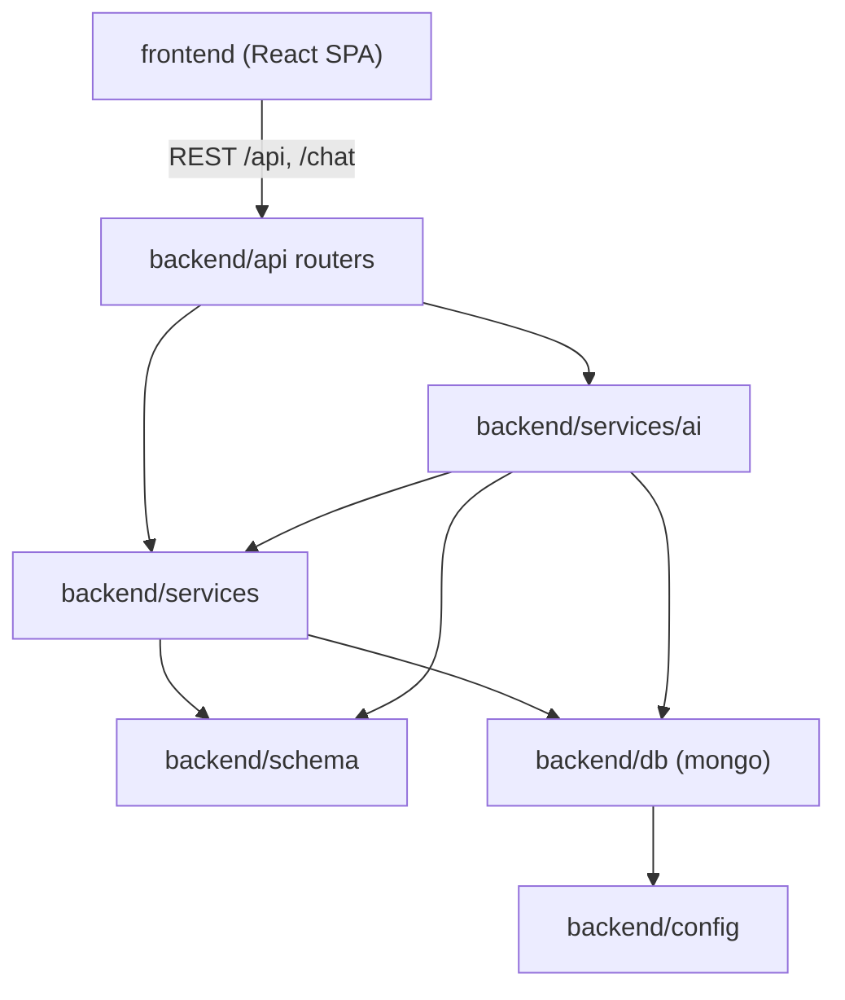

# Dependencies

## Internal Dependencies

### frontend depends on backend API
- **Type**: Runtime (HTTP).
- **Reason**: All data (auth, profile, bookings, InBody, chat, notifications) served by FastAPI.

### api routers depend on services + ai
- **Type**: Compile/Runtime.
- **Reason**: Routers delegate business logic to services and the AI Coach.

### services + ai depend on db (mongo) and schema
- **Type**: Compile/Runtime.
- **Reason**: Persistence and typed document models.

### ai depends on booking service
- **Type**: Runtime.
- **Reason**: Booking tools (`book_slot`, availability) reuse booking-service logic.

## External Dependencies

### Backend
- **fastapi** — web framework. License: MIT.
- **uvicorn[standard]** — ASGI server. License: BSD.
- **pydantic / pydantic-settings** — validation + config. License: MIT.
- **pymongo** — MongoDB driver. License: Apache-2.0.
- **anthropic** — Claude SDK. License: MIT.
- **passlib[bcrypt] / bcrypt** — password hashing. License: BSD / Apache-2.0.
- **python-dotenv** — env loading. License: BSD.
- **pytest** — testing. License: MIT.

### Frontend (selected)
- **react / react-dom** 18.3.1 — MIT.
- **vite** 6.3.5 — MIT.
- **tailwindcss** 4.1.12 — MIT.
- **react-router** 7.13.0 — MIT.
- **@radix-ui/** primitives — MIT.
- **@mui/material** 7 + **@emotion/** — MIT.
- **recharts** ^2.15 — MIT.
- **react-markdown** ^10 — MIT.
- **lucide-react** — ISC.

> Note: License entries reflect the well-known licenses of these packages; verify against the
> installed lockfile if license compliance is a formal requirement.
