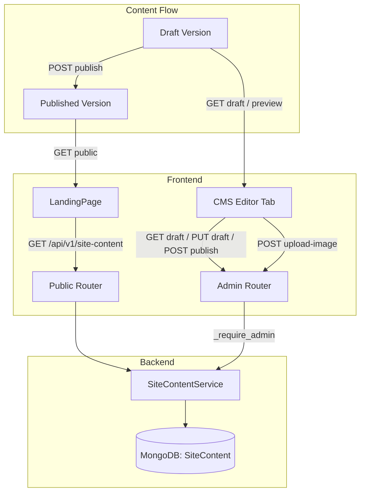
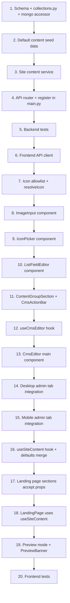

# Design Document: Landing Page CMS

## Overview

This feature converts the Renfit landing page from hardcoded TSX content to a dynamic, admin-editable system. The architecture introduces:

1. A **MongoDB singleton document** (`SiteContent`) storing a full content tree with separate `draft` and `published` versions.
2. A **backend service + router** (`site_content_service.py`, `api/site_content.py`) exposing public read and trainer-only CRUD/publish endpoints.
3. A **CMS Editor** tab in the admin dashboard (both desktop and mobile) with form-based editing, list management, image upload, and icon picking.
4. A **dynamic Landing Page** that fetches published content on mount, merges with hardcoded defaults for graceful degradation, and supports a `?preview=true` mode for draft viewing.

The design preserves the existing pattern: thin routers → services → MongoDB, admin auth via `_require_admin`, and the frontend's device-based tab architecture.

---

## Architecture



### Key design decisions

| Decision | Rationale |
|----------|-----------|
| MongoDB singleton (`_id: "site_content"`) with `find_one` + `upsert` | Simplest model for a single-document store; no multi-tenancy needed (one gym). |
| Draft/published in one document | Atomic publish via `$set: {published: draft}` — no cross-document consistency issues. |
| Base64 images stored inline in the content document | Avoids file storage infra; content images are small (~800px max, JPEG-compressed). Max 2MB per image. |
| Icon allowlist resolved at runtime via a map | Avoids dynamic `import()` / tree-shaking issues; 24 icons is a fixed, small set. |
| `useSiteContent` hook for the landing page | Single hook provides content + loading state + fallback merge; both device trees reuse it. |
| Hardcoded defaults rendered immediately (no spinner) | SSR-like feel — visitor sees content instantly, then hydrates with dynamic data seamlessly. |

---

## Components and Interfaces

### Backend

#### New files

| File | Role |
|------|------|
| `backend/src/schema/site_content.py` | Pydantic models for the content document |
| `backend/src/services/site_content_service.py` | Business logic: get, save draft, publish, seed, validate, upload |
| `backend/src/api/site_content.py` | FastAPI router: public + admin endpoints |

#### Router: `src/api/site_content.py`

```python
# Public (no auth)
GET  /api/v1/site-content              → PublishedContentResponse

# Admin (trainer-only, _require_admin)
GET  /api/v1/admin/site-content/draft   → DraftContentResponse
PUT  /api/v1/admin/site-content/draft   → SaveDraftResponse
POST /api/v1/admin/site-content/publish → PublishResponse
POST /api/v1/admin/site-content/upload-image → UploadImageResponse
```

#### Service: `src/services/site_content_service.py`

```python
class SiteContentService:
    def get_published() -> dict
    def get_draft() -> dict
    def save_draft(content: SiteContentTree, trainer_id: str) -> SaveResult
    def publish(trainer_id: str) -> PublishResult
    def upload_image(base64_data: str, format: str) -> str
    def _seed_default() -> dict  # internal: creates initial document
    def _validate_content(content: dict) -> list[str]  # returns missing field names
```

### Frontend

#### New files

| File | Role |
|------|------|
| `frontend/src/lib/api/siteContent.ts` | API client (fetch wrappers) |
| `frontend/src/app/shared/hooks/useSiteContent.ts` | Hook for landing page: fetch + merge defaults |
| `frontend/src/app/shared/hooks/useCmsEditor.ts` | Hook for CMS editor: load draft, save, publish, dirty state |
| `frontend/src/app/shared/components/CmsEditor.tsx` | Main CMS form component (used by both desktop/mobile) |
| `frontend/src/app/shared/components/ImageInput.tsx` | Dual-mode image field (URL + file upload) |
| `frontend/src/app/shared/components/IconPicker.tsx` | Curated icon dropdown |
| `frontend/src/app/shared/components/ListFieldEditor.tsx` | Generic ordered list editor with add/remove/reorder |
| `frontend/src/app/shared/components/ContentGroupSection.tsx` | Collapsible section wrapper for each group |
| `frontend/src/app/shared/components/PreviewBanner.tsx` | Fixed banner for preview mode |
| `frontend/src/app/shared/components/CmsActionBar.tsx` | Save draft / Preview / Publish buttons + dirty indicator |
| `frontend/src/lib/icons/iconAllowlist.ts` | Icon name → component map + Vietnamese labels |

#### Modified files

| File | Change |
|------|--------|
| `frontend/src/app/desktop/components/DesktopAdminHeader.tsx` | Add `'cms'` to view union, add "Trang chủ" tab button |
| `frontend/src/app/desktop/pages/AdminDashboardPage.tsx` | Add `view === 'cms'` branch rendering `<CmsEditor />` |
| `frontend/src/app/mobile/shell/AdminBottomTabBar.tsx` | Add `'cms'` to `AdminMobileTabKey`, add tab entry |
| `frontend/src/app/mobile/pages/AdminDashboardPage.tsx` | Add `activeTab === 'cms'` branch rendering `<CmsEditor />` |
| `frontend/src/app/pages/LandingPage.tsx` | Use `useSiteContent()` hook, pass content to sections |
| `frontend/src/app/components/Hero.tsx` | Accept content props instead of hardcoded data |
| `frontend/src/app/components/About.tsx` | Accept content props |
| `frontend/src/app/components/Services.tsx` | Accept content props |
| `frontend/src/app/components/AIChat.tsx` | Accept content props |
| `frontend/src/app/components/Trainers.tsx` | Accept content props |
| `frontend/src/app/components/landing/ClosingCTA.tsx` | Accept content props |
| `frontend/src/app/components/Footer.tsx` | Accept content props |
| `backend/src/schema/collections.py` | Add `SITE_CONTENT = "SiteContent"` |
| `backend/src/db/mongo.py` | Add `site_content_collection()` accessor |
| `backend/src/main.py` | Register `site_content_router` |

---

## Data Models

### MongoDB Document: `SiteContent` collection

```json
{
  "_id": "site_content",
  "draft": { /* SiteContentTree */ },
  "published": { /* SiteContentTree */ },
  "draft_updated_at": "2025-01-15T10:30:00Z",
  "draft_updated_by": "trainer_id",
  "published_at": "2025-01-15T09:00:00Z",
  "published_by": "trainer_id"
}
```

### TypeScript: `SiteContentTree` interface

```typescript
// frontend/src/lib/api/siteContent.ts

export interface SiteContentTree {
  brand: BrandContent;
  hero: HeroContent;
  about: AboutContent;
  services: ServicesContent;
  ai_coach: AiCoachContent;
  trainers: TrainersContent;
  closing_cta: ClosingCtaContent;
  contact: ContactContent;
  social: SocialContent;
  footer: FooterContent;
}

export interface BrandContent {
  logo_url: string;
  name: string;
  tagline: string;
}

export interface HeroContent {
  headline_line1: string;
  headline_line2: string;
  headline_line3: string;
  description: string;
  background_image: string;
  stats: HeroStat[];
}

export interface HeroStat {
  icon: string;       // lucide-react icon name or ""
  value: string;      // e.g. "100+"
  label: string;      // e.g. "Hội viên"
}

export interface AboutContent {
  title: string;
  subtitle: string;
  main_image: string;
  main_image_title: string;
  main_image_description: string;
  features: AboutFeature[];
}

export interface AboutFeature {
  icon: string;
  title: string;
  description: string;
}

export interface ServicesContent {
  title: string;
  subtitle: string;
  items: ServiceItem[];
}

export interface ServiceItem {
  icon: string;
  title: string;
  description: string;
}

export interface AiCoachContent {
  badge_text: string;
  title: string;
  subtitle: string;
  messages: AiChatMessage[];
}

export interface AiChatMessage {
  type: 'user' | 'ai';
  message: string;
}

export interface TrainersContent {
  title: string;
  subtitle: string;
  items: TrainerItem[];
}

export interface TrainerItem {
  name: string;
  specialty: string;
  experience: string;
  image: string;
  certifications: string;
}

export interface ClosingCtaContent {
  title: string;
  subtitle: string;
  primary_button_label: string;
  secondary_button_label: string;
}

export interface ContactContent {
  address: string;
  phone: string;
  email: string;
  hours: string;
}

export interface SocialContent {
  facebook_url: string;
  instagram_url: string;
  youtube_url: string;
}

export interface FooterContent {
  brand_description: string;
  copyright: string;
  nav_about_label: string;
  nav_services_label: string;
  nav_trainers_label: string;
  nav_contact_label: string;
}
```

### Python: `src/schema/site_content.py`

```python
from datetime import datetime
from typing import Optional
from pydantic import BaseModel, Field


class HeroStat(BaseModel):
    icon: str = ""
    value: str
    label: str


class AboutFeature(BaseModel):
    icon: str = ""
    title: str
    description: str


class ServiceItem(BaseModel):
    icon: str = ""
    title: str
    description: str


class AiChatMessage(BaseModel):
    type: str  # "user" | "ai"
    message: str


class TrainerItem(BaseModel):
    name: str
    specialty: str
    experience: str
    image: str = ""
    certifications: str = ""


class BrandContent(BaseModel):
    logo_url: str = ""
    name: str = "Renfit"
    tagline: str = ""


class HeroContent(BaseModel):
    headline_line1: str
    headline_line2: str
    headline_line3: str
    description: str
    background_image: str = ""
    stats: list[HeroStat] = []


class AboutContent(BaseModel):
    title: str
    subtitle: str
    main_image: str = ""
    main_image_title: str = ""
    main_image_description: str = ""
    features: list[AboutFeature] = []


class ServicesContent(BaseModel):
    title: str
    subtitle: str
    items: list[ServiceItem] = []


class AiCoachContent(BaseModel):
    badge_text: str = ""
    title: str
    subtitle: str
    messages: list[AiChatMessage] = []


class TrainersContent(BaseModel):
    title: str
    subtitle: str
    items: list[TrainerItem] = []


class ClosingCtaContent(BaseModel):
    title: str
    subtitle: str
    primary_button_label: str
    secondary_button_label: str


class ContactContent(BaseModel):
    address: str
    phone: str
    email: str
    hours: str


class SocialContent(BaseModel):
    facebook_url: str = ""
    instagram_url: str = ""
    youtube_url: str = ""


class FooterContent(BaseModel):
    brand_description: str
    copyright: str
    nav_about_label: str = "Về Chúng Tôi"
    nav_services_label: str = "Dịch Vụ"
    nav_trainers_label: str = "Huấn Luyện Viên"
    nav_contact_label: str = "Liên Hệ"


class SiteContentTree(BaseModel):
    brand: BrandContent
    hero: HeroContent
    about: AboutContent
    services: ServicesContent
    ai_coach: AiCoachContent
    trainers: TrainersContent
    closing_cta: ClosingCtaContent
    contact: ContactContent
    social: SocialContent
    footer: FooterContent


class SiteContentDocument(BaseModel):
    """Full MongoDB document shape."""
    id: str = Field(default="site_content", alias="_id")
    draft: SiteContentTree
    published: SiteContentTree
    draft_updated_at: Optional[datetime] = None
    draft_updated_by: Optional[str] = None
    published_at: Optional[datetime] = None
    published_by: Optional[str] = None
```

### Icon Allowlist

```typescript
// frontend/src/lib/icons/iconAllowlist.ts
import {
  Dumbbell, Bot, Apple, TrendingUp, Scale, Flame, Heart,
  Target, Zap, Award, Users, Star, Activity, Bike, Timer,
  Mountain, Salad, Footprints, Brain, Shield, Gauge, Waves,
  Sunrise, Leaf,
} from 'lucide-react';
import type { LucideIcon } from 'lucide-react';

export interface IconEntry {
  name: string;
  icon: LucideIcon;
  label: string; // Vietnamese display name
}

export const ICON_ALLOWLIST: IconEntry[] = [
  { name: 'Dumbbell', icon: Dumbbell, label: 'Tạ' },
  { name: 'Bot', icon: Bot, label: 'Robot' },
  { name: 'Apple', icon: Apple, label: 'Táo' },
  { name: 'TrendingUp', icon: TrendingUp, label: 'Xu hướng' },
  { name: 'Scale', icon: Scale, label: 'Cân' },
  { name: 'Flame', icon: Flame, label: 'Lửa' },
  { name: 'Heart', icon: Heart, label: 'Tim' },
  { name: 'Target', icon: Target, label: 'Mục tiêu' },
  { name: 'Zap', icon: Zap, label: 'Sấm sét' },
  { name: 'Award', icon: Award, label: 'Giải thưởng' },
  { name: 'Users', icon: Users, label: 'Nhóm' },
  { name: 'Star', icon: Star, label: 'Ngôi sao' },
  { name: 'Activity', icon: Activity, label: 'Hoạt động' },
  { name: 'Bike', icon: Bike, label: 'Xe đạp' },
  { name: 'Timer', icon: Timer, label: 'Đồng hồ' },
  { name: 'Mountain', icon: Mountain, label: 'Núi' },
  { name: 'Salad', icon: Salad, label: 'Salad' },
  { name: 'Footprints', icon: Footprints, label: 'Bước chân' },
  { name: 'Brain', icon: Brain, label: 'Não' },
  { name: 'Shield', icon: Shield, label: 'Khiên' },
  { name: 'Gauge', icon: Gauge, label: 'Đồng hồ đo' },
  { name: 'Waves', icon: Waves, label: 'Sóng' },
  { name: 'Sunrise', icon: Sunrise, label: 'Bình minh' },
  { name: 'Leaf', icon: Leaf, label: 'Lá' },
];

/** Map for O(1) lookup by name */
export const ICON_MAP: Record<string, LucideIcon> = Object.fromEntries(
  ICON_ALLOWLIST.map((e) => [e.name, e.icon]),
);

/** Resolve an icon name to a component, or null if not in allowlist. */
export function resolveIcon(name: string | undefined | null): LucideIcon | null {
  if (!name) return null;
  return ICON_MAP[name] ?? null;
}
```

---

## Correctness Properties

*A property is a characteristic or behavior that should hold true across all valid executions of a system — essentially, a formal statement about what the system should do. Properties serve as the bridge between human-readable specifications and machine-verifiable correctness guarantees.*

### Property 1: Content Document schema completeness

*For any* valid `SiteContentDocument`, both the `draft` and `published` keys must exist and each must contain exactly the 10 required Content_Group keys: `brand`, `hero`, `about`, `services`, `ai_coach`, `trainers`, `closing_cta`, `contact`, `social`, `footer`.

**Validates: Requirements 1.2, 1.4**

### Property 2: List ordering round-trip

*For any* list field (services items, trainers items, hero stats, about features, AI coach messages) containing N items in a specific order, storing the list via `PUT draft` and then retrieving it via `GET draft` shall return the items in the exact same order (index-by-index equality).

**Validates: Requirements 1.5**

### Property 3: Draft validation rejects incomplete payloads

*For any* `SiteContentTree` payload with at least one required field removed (from any of the 10 groups), the `PUT /api/v1/admin/site-content/draft` endpoint shall return a 422 response containing a Vietnamese error message identifying the missing field(s).

**Validates: Requirements 3.3**

### Property 4: Draft/Published isolation

*For any* draft content saved via `PUT /api/v1/admin/site-content/draft`, the `published` version of the `SiteContentDocument` shall remain byte-for-byte identical to its state before the save operation.

**Validates: Requirements 3.5**

### Property 5: Publish copies draft to published

*For any* draft content, after calling `POST /api/v1/admin/site-content/publish`, the response from `GET /api/v1/site-content` (public endpoint) shall return content identical to the draft at the time of publish.

**Validates: Requirements 4.1**

### Property 6: List management preserves data integrity

*For any* list of N items and any sequence of add, remove, and reorder operations: (a) adding an item to a list of N items produces N+1 items with the new item at the end; (b) removing item at index i from a list of N items produces N-1 items with item i absent and all others preserved in relative order; (c) moving item from position i to position j produces a list with all original items (no loss or duplication) in the expected new order.

**Validates: Requirements 10.2, 10.3, 10.4**

### Property 7: Icon resolver correctness

*For any* icon name string in the curated allowlist of 24 icons, `resolveIcon(name)` shall return a valid React component (non-null). *For any* string not present in the allowlist (including empty string and undefined), `resolveIcon(name)` shall return null.

**Validates: Requirements 9.3, 13.7**

### Property 8: Image upload size validation

*For any* base64-encoded image string whose byte length exceeds 2MB (2,097,152 bytes), the `POST /api/v1/admin/site-content/upload-image` endpoint shall return a 413 status code with a Vietnamese error message.

**Validates: Requirements 14.3**

### Property 9: Content merge with defaults (graceful degradation)

*For any* API response from `GET /api/v1/site-content` that is missing arbitrary fields (including completely empty response or network error), the `useSiteContent` hook's merged output shall contain all fields defined in `SiteContentTree`, with missing fields filled from the hardcoded default values.

**Validates: Requirements 2.4, 15.2**

### Property 10: Dirty state detection

*For any* two `SiteContentTree` objects (representing current draft form state and last-published content) where at least one primitive field value differs, the dirty-detection logic shall return `true`. When both trees are deeply equal, it shall return `false`.

**Validates: Requirements 11.5**

### Property 11: Image compression output validity

*For any* valid image file (JPEG, PNG, WebP) passed to `compressImageToBase64(file, 800)`, the output shall be a valid base64 data URL string, and decoding it shall produce an image with both width and height ≤ 800px.

**Validates: Requirements 8.2**

### Property 12: Dynamic landing page renders content fields

*For any* valid `SiteContentTree`, rendering the Landing Page with that content shall produce DOM elements containing the text values from: `hero.headline_line1`, each `services.items[].title`, each `trainers.items[].name`, `closing_cta.title`, and `footer.copyright`.

**Validates: Requirements 13.1, 13.2, 13.3, 13.4, 13.5, 13.6**

---

## Error Handling

### Backend

| Scenario | Status | Response |
|----------|--------|----------|
| No Content_Document exists (any GET) | 200 | Auto-seed from defaults, return seeded content |
| PUT draft with missing required fields | 422 | `{ "detail": "Thiếu trường bắt buộc: {field_name}" }` |
| PUT draft with invalid JSON | 422 | Pydantic validation error (auto-formatted by FastAPI) |
| POST upload-image with >2MB payload | 413 | `{ "detail": "Ảnh vượt quá kích thước tối đa 2MB." }` |
| POST upload-image with unsupported format | 422 | `{ "detail": "Định dạng ảnh không được hỗ trợ. Chấp nhận: JPEG, PNG, WebP." }` |
| Unauthenticated admin endpoint access | 401 | `{ "detail": "Không có quyền truy cập." }` |
| MongoDB write failure | 500 | `{ "detail": "Lỗi hệ thống, vui lòng thử lại." }` |

### Frontend

| Scenario | Behavior |
|----------|----------|
| Public content fetch fails / times out (5s) | Render with hardcoded defaults; no error UI visible to visitor |
| Public content partially missing fields | Deep-merge with defaults (field-level granularity) |
| Draft save fails | Error toast: API error message or "Lưu nháp thất bại." |
| Publish fails | Error toast: API error message or "Xuất bản thất bại." |
| Image upload fails | Error toast: API error message |
| Draft load fails in CMS editor | Error state with retry button |

---

## Testing Strategy

### Backend tests (`backend/test/test_site_content.py`)

**Unit tests (pytest):**
- Seeding logic produces correct default document shape
- Validation catches all required fields for each of the 10 groups
- Publish copies draft → published atomically
- Draft save does not touch published
- Image size check rejects >2MB
- Image format check rejects unsupported types

**Property-based tests (Hypothesis):**
- Property 1: Schema completeness — generated content trees always have all 10 groups
- Property 2: List ordering preserved through save/retrieve cycle
- Property 3: Missing-field validation (remove random required fields → 422)
- Property 4: Draft/Published isolation
- Property 5: Publish produces published === draft

### Frontend tests

**Unit/RTL tests (Vitest + RTL):**
- `IconPicker.test.tsx` — renders allowlist, selection stores name, "Không có icon" option
- `ImageInput.test.tsx` — URL mode stores URL, file mode triggers compression, clear works
- `ListFieldEditor.test.tsx` — add/remove/reorder operations
- `CmsEditor.test.tsx` — loads draft on mount, 10 collapsible sections, save/publish calls API
- `useSiteContent.test.ts` — fetch, fallback on error, merge partial response
- `PreviewBanner.test.tsx` — renders in preview mode, hidden otherwise
- Landing page sections — verify props-based rendering replaces hardcoded data

**Property-based tests (fast-check):**
- Property 6: List management integrity (add/remove/reorder sequences)
- Property 7: Icon resolver — allowlist names → non-null, others → null
- Property 9: Content merge with defaults — any partial tree merged produces complete tree
- Property 10: Dirty detection — differs iff at least one field differs
- Property 12: Landing page renders provided content fields

### Test configuration
- Property tests: minimum 100 iterations per property
- Tag format: `Feature: landing-page-cms, Property {N}: {title}`
- Backend: `hypothesis` library (already available via pytest ecosystem)
- Frontend: `fast-check` (already in the project)

---

## Implementation Order



### Task grouping

| Phase | Tasks | Description |
|-------|-------|-------------|
| Backend foundation | 1–5 | Schema, service, router, tests |
| Frontend infrastructure | 6–7 | API client, icon system |
| CMS building blocks | 8–11 | Reusable editor components |
| CMS assembly | 12–13 | Hook + main editor |
| Admin integration | 14–15 | Add tab to desktop + mobile dashboards |
| Landing page dynamic | 16–19 | Hook, section refactor, preview |
| Frontend verification | 20 | Component + property tests |
